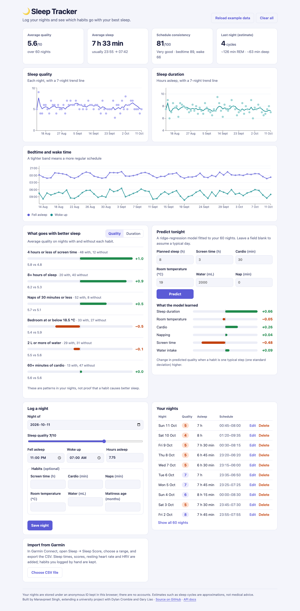
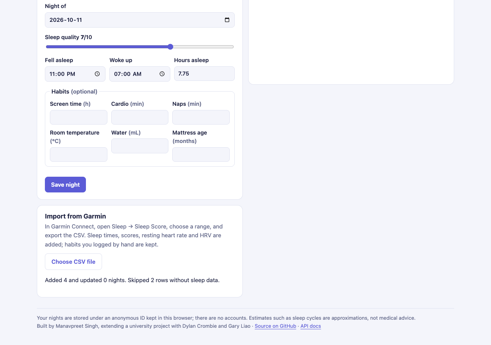
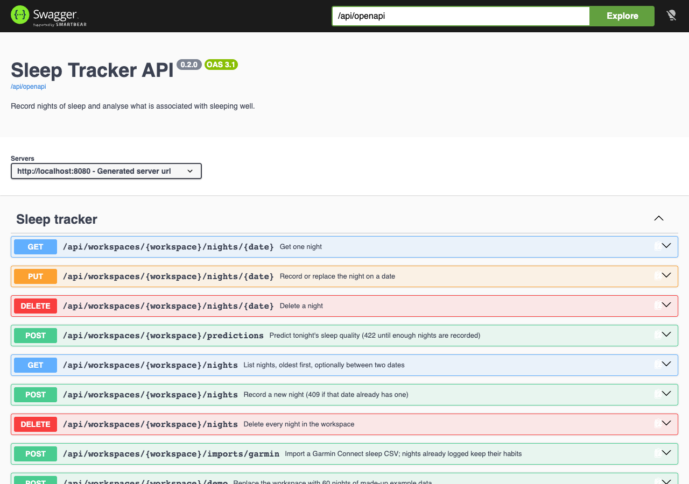
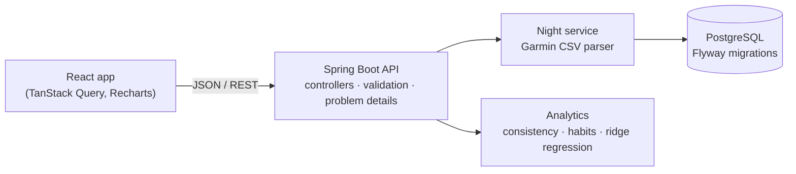

# 🌙 Sleep Tracker

[](https://github.com/manavpreet1809/Sleep-Tracker/actions/workflows/ci.yml)

Log your nights, import a Garmin export, and see how regular your schedule is, which habits go with your best sleep, and a prediction for tonight from a model trained on your own nights.

A full-stack rebuild of a JavaFX university project: **Java 25 · Spring Boot 4 · PostgreSQL · React 19 · TypeScript · Docker**.


## Features

- **Log nights** with quality, bedtime, wake time and hours asleep, plus optional habits: screen time, cardio, naps, room temperature, water and mattress age.
- **Import from Garmin Connect**: upload the sleep CSV; scores, times, resting heart rate and HRV are added, and habits you logged by hand are kept.
- **Trends**: nightly quality and duration with 7-night weighted averages, and a bedtime/wake-time chart that handles schedules crossing midnight.
- **Schedule consistency** score (0-100) from the variance of bedtime, wake time and duration.
- **What goes with better sleep**: average quality or duration on nights with versus without each habit.
- **Predict tonight**: a ridge-regression model fitted to the user's own nights, with the effect it learned for each habit.
- **No accounts**: each browser gets an anonymous workspace ID, so visitors' data stays separate. One click loads 60 example nights.
- Dark mode, phone layout, and interactive API docs.

| Habits and prediction | Garmin import | API docs |
|---|---|---|
|  |  |  |

## Tech stack

| Layer | Technology |
|---|---|
| API | Java 25, Spring Boot 4.1 (Web MVC, Data JPA, Validation, Actuator), springdoc OpenAPI |
| Data | PostgreSQL 18 with Flyway migrations; H2 in-memory for the hosted demo |
| Web app | React 19, TypeScript, Vite, TanStack Query, Recharts |
| Testing | JUnit 5, Spring MockMvc, Testcontainers (real PostgreSQL), JaCoCo; Vitest, Testing Library |
| Delivery | Multi-stage Docker image, Docker Compose, GitHub Actions CI |

## Architecture



The analytics are plain Java with no framework dependencies (`backend/src/main/java/.../analytics`), so they are unit-tested directly. The React build is bundled into the Spring Boot jar and served from the same origin.

## Run it

**With Docker** (only Docker needed):

```sh
docker compose up --build
```

Open <http://localhost:8080> for the app and <http://localhost:8080/api/docs> for the API docs.

**For development:**

```sh
# API on :8080 with the in-memory database (needs Java 25)
cd backend && ./mvnw spring-boot:run -Dspring-boot.run.profiles=demo

# Web app on :5173 with hot reload, proxying /api to :8080 (needs Node 24)
cd frontend && npm install && npm run dev
```

Without the `demo` profile the API connects to PostgreSQL at `localhost:5432` (database, user and password `sleeptracker`), or wherever `SPRING_DATASOURCE_URL` points.

## API

All endpoints are under `/api/workspaces/{workspace}`, where `workspace` is a client-chosen UUID. Errors are [RFC 9457](https://www.rfc-editor.org/rfc/rfc9457) problem details, with per-field messages for invalid input.

| Method | Path | Purpose |
|---|---|---|
| `GET` | `/nights?from=&to=` | List nights, oldest first |
| `PUT` | `/nights/{date}` | Record or replace a night |
| `POST` | `/nights` | Record a new night (409 if the date exists) |
| `DELETE` | `/nights/{date}` | Delete a night |
| `GET` | `/analysis` | Averages, consistency, habit comparisons, model and trend |
| `POST` | `/predictions` | Predict tonight's quality (422 until 7 comparable nights exist) |
| `POST` | `/imports/garmin` | Upload a Garmin Connect sleep CSV (multipart, up to 1 MB) |
| `POST` | `/demo` | Replace the workspace with 60 example nights |

## How the analysis works

- **Consistency**: sample variance of bedtime and wake time measured around the clock (23:30 and 00:30 are one hour apart), and of sleep duration, mapped to 0-100 and weighted 40/40/20.
- **Habits**: for each habit, the average outcome on nights it was followed versus nights it was not, using only nights where it was recorded. These are associations in the user's own data, not causes.
- **Prediction**: ridge regression (λ = 1) on standardized habits recorded on at least 80% of nights, solved with Gaussian elimination. The penalty keeps coefficients stable with few nights, and predictions are clamped to 1-10.
- **Sleep cycles** are a rough estimate from duration and self-rated quality, not a measurement.

Nothing here is medical advice.

## Importing from Garmin

In Garmin Connect, open **Sleep → Sleep Score**, choose a date range and export the CSV. Then use **Import from Garmin** in the app. Garmin labels each night by the morning it ended; the app labels nights by the evening they began. The 0-100 sleep score becomes the 1-10 quality, and rows without sleep data are listed rather than failing the import.

## Tests

```sh
cd backend && ./mvnw verify        # 62 tests; API tests start PostgreSQL in Docker; coverage in target/site/jacoco
cd frontend && npm run lint && npm test
```

Backend line coverage is about 96%. CI runs both suites and builds the Docker image on every push.

## Project history

Sleep Tracker began as a JavaFX desktop app for CPSC 233 at the University of Calgary, built by **Manavpreet Singh, Dylan Crombie and Gary Liao**. That version, which stored nights in a CSV file, is preserved at the [`javafx-v1`](https://github.com/manavpreet1809/Sleep-Tracker/tree/javafx-v1) tag.

Manavpreet Singh rebuilt it as a web application, keeping the team's analytics ideas (the circular average of bedtimes, consistency scoring, habit thresholds and sleep-cycle estimates) and correcting three behaviours along the way:

- The habit analysis counted every good night towards every habit; it now compares nights with and without each habit.
- Wake times on either side of noon looked 23 hours apart in the consistency score; times are now compared around the clock.
- The quality prediction scaled correlations by hand-picked constants; it is now a ridge regression fitted to the user's data.
