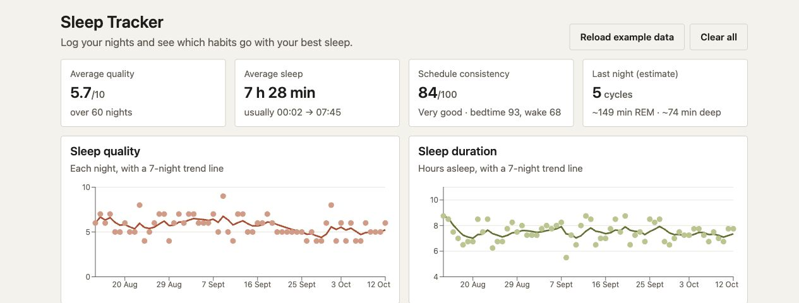

# Sleep Tracker

Log sleep, import Garmin CSV files, and explore sleep trends and daily habits.

**Built with:** Java, Spring Boot, PostgreSQL, React, and TypeScript.



## A night at a time

Enter sleep times manually or import a Garmin CSV. The dashboard brings those
records together so you can compare nights, follow trends, and look for habits
associated with better sleep. These comparisons do not establish cause and effect.

## Start tracking

With Docker installed:

```sh
docker compose up --build
```

Open [localhost:8080](http://localhost:8080).
API documentation is at [localhost:8080/api/docs](http://localhost:8080/api/docs).
The included database credentials are for local development only.

## Working on the code

Backend (requires Java 25 and Docker):

```sh
cd backend
./mvnw verify
```

Frontend (requires Node.js 24; run from the project root in another terminal):

```sh
cd frontend
npm install
npm test
```

## Where it started

There are no user accounts. Sleep estimates are not medical advice.

Started as a CPSC 233 JavaFX group project by Manavpreet Singh, Dylan Crombie,
and Gary Liao. The original is preserved in [javafx-v1](https://github.com/manavpreet1809/Sleep-Tracker/tree/javafx-v1).
